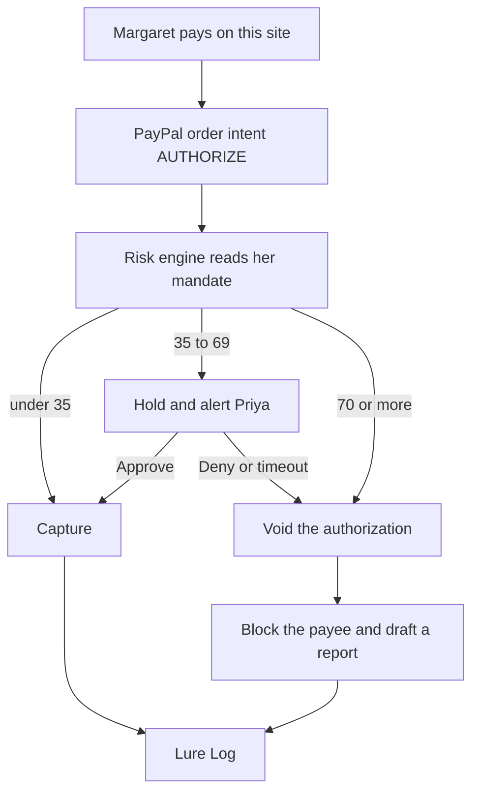

# AEGIS

AI consent proxy that enforces a vulnerable person's own wishes on every PayPal transaction.

A senior pays **through AEGIS**. AEGIS is the PayPal merchant: each payment is created with Orders v2 `intent=AUTHORIZE`, then a risk engine decides whether to capture it, hold it for a guardian, or void it.

Payments made directly in the PayPal app never reach AEGIS and cannot be intercepted.

## Why it exists

Margaret writes her wishes in ordinary sentences. AEGIS turns them into a versioned mandate: a cap for someone she has not paid before, a per-payment cap, a daily cap, people who are always allowed or always blocked, scam words, quiet hours, and Priya's name. The next payment is scored against that mandate. A low score is captured. A middle score waits for Priya. A high score is voided, the payee is blocked, and a draft complaint is saved. The Lure Log keeps every reason.

## Architecture



The score adds up the amount, a new payee, velocity, drift from her history, quiet hours, and scam wording. An always-block list forces a void. An always-allow list keeps a trusted payee low unless the note itself looks like a scam. Below 35 is low, 35 to 69 is medium, and 70 or more is high. Grok may rewrite the sentences. It does not change the score.

## PayPal sandbox

AEGIS is the merchant app. Create the app in the PayPal developer dashboard and leave it on sandbox.

1. Create a sandbox REST app. Copy the client id and secret into `.env` as `PAYPAL_CLIENT_ID` and `PAYPAL_CLIENT_SECRET`.
2. Keep `PAYPAL_ENV=sandbox`.
3. Create a sandbox personal account. On **Send money**, that account approves the PayPal button. The order is an authorization, not a capture. AEGIS captures or voids after the risk check.
4. For webhooks, run `ngrok http 8787`.
5. On the app, subscribe `https://<ngrok-host>/api/webhooks/paypal` to `PAYMENT.AUTHORIZATION.CREATED`, `PAYMENT.AUTHORIZATION.VOIDED`, and `PAYMENT.CAPTURE.COMPLETED`.
6. Copy the webhook id into `PAYPAL_WEBHOOK_ID`.

Leave the client id and secret empty to use the in-process practice merchant. The three buttons on `/demo` do not need a buyer. A payment from `/senior/pay` needs the sandbox app and the PayPal button.

`XAI_API_KEY` and `XAI_MODEL` let Grok compile a mandate and rewrite reasons. With no key, compilation stays on this machine. Either way the model does not choose the outcome.

## Demo script

```bash
npm install
cp .env.example .env
npm run dev
```

Open http://localhost:5173/demo. The seed is Margaret, her daughter Priya, and twenty past payments each to CVS Pharmacy and City Utilities. Her words are: never more than $500 to someone she has not paid before, always allow the pharmacy and the utility company, and block anything urgent and secret.

1. **Pay CVS Pharmacy $48.** The result says it was sent. The Lure Log shows a low score.
2. **Pay Helen Brooks $650.** The result waits. Open Guardian, then Approve to send it or Deny to stop it.
3. **Pay Officer James $1,900.** The note says it is urgent, secret, and about a grandson's bail. The result says it was stopped. In the Lure Log, select that row, download the report, and download the CSV.

`npm test` checks the same three decisions. `npm run e2e` clicks through them in Chromium.
