# AEGIS

AI consent proxy that enforces a vulnerable person's own wishes on every PayPal transaction.

A senior pays **through AEGIS**. AEGIS is the PayPal merchant: each payment is created with Orders v2 `intent=AUTHORIZE`, then a risk engine decides whether to capture it, hold it for a guardian, or void it.

Payments made directly in the PayPal app never reach AEGIS and cannot be intercepted.

**Live demo:** https://aneek22112007-tech.github.io/aegis/ (runs entirely in your browser, no account or real money)

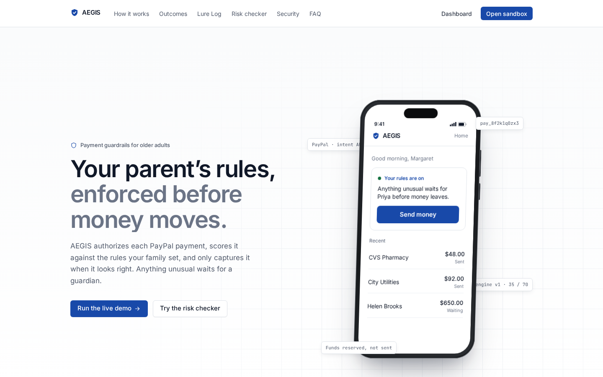

## Why it exists

Margaret writes her wishes in ordinary sentences. AEGIS turns them into a versioned mandate: a cap for someone she has not paid before, a per-payment cap, a daily cap, people who are always allowed or always blocked, scam words, quiet hours, and Priya's name. The next payment is scored against that mandate. A low score is captured. A middle score waits for Priya. A high score is voided, the payee is blocked, and a draft complaint is saved. The Lure Log keeps every reason.

## Architecture

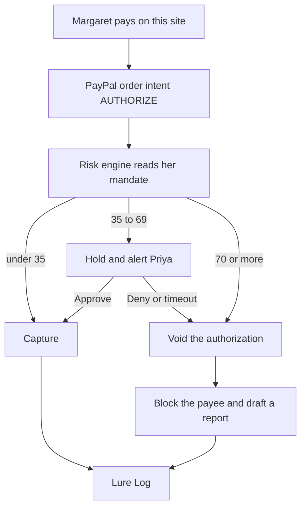

The score adds up the amount, a new payee, velocity, drift from her history, quiet hours, and scam wording. An always-block list forces a void. An always-allow list keeps a trusted payee low unless the note itself looks like a scam. Below 35 is low, 35 to 69 is medium, and 70 or more is high. Grok may rewrite the sentences. It does not change the score.

## PayPal sandbox

AEGIS is the merchant app. Create the app in the PayPal developer dashboard and leave it on sandbox.

1. Create a sandbox REST app. Copy the client id and secret into `.env` as `PAYPAL_CLIENT_ID` and `PAYPAL_CLIENT_SECRET`.
2. Keep `PAYPAL_ENV=sandbox`.
3. Create a sandbox personal account. On **Send money**, that account approves the PayPal button. The order is an authorization, not a capture. AEGIS captures or voids after the risk check.
4. For webhooks, run `ngrok http 8787`.
5. On the app, subscribe `https://<ngrok-host>/api/webhooks/paypal` to `PAYMENT.AUTHORIZATION.CREATED`, `PAYMENT.AUTHORIZATION.VOIDED`, and `PAYMENT.CAPTURE.COMPLETED`.
6. Copy the webhook id into `PAYPAL_WEBHOOK_ID`.

Leave the client id and secret empty to use the in-process practice merchant. The three buttons on `/demo` do not need a buyer. A payment from `/senior/pay` needs the sandbox app and the PayPal button.

`XAI_API_KEY` and `XAI_MODEL` let Grok compile a mandate and rewrite reasons. With no key, compilation stays on this machine. Either way the model does not choose the outcome.

## Demo script

```bash
npm install
cp .env.example .env
npm run dev
```

Open http://localhost:5173 for the landing page, or http://localhost:5173/demo to run the payments. The seed is Margaret, her daughter Priya, and twenty past payments each to CVS Pharmacy and City Utilities. Her words are: never more than $500 to someone she has not paid before, always allow the pharmacy and the utility company, and block anything urgent and secret.

1. **Pay CVS Pharmacy $48.** The result says it was sent. The Lure Log shows a low score.
2. **Pay Helen Brooks $650.** The result waits. Open Guardian, then Approve to send it or Deny to stop it.
3. **Pay Officer James $1,900.** The note says it is urgent, secret, and about a grandson's bail. The result says it was stopped. In the Lure Log, select that row, download the report, and download the CSV.

`npm test` checks the same three decisions. `npm run e2e` clicks through them in Chromium.

## Live demo mode

The GitHub Pages build sets `VITE_DEMO_MODE=true`. The browser runs a copy of the same risk engine the server uses (a parity test keeps them in step) and a practice merchant. State lives in `localStorage`, and guardian alerts travel between tabs over a `BroadcastChannel`. **Start over** on the demo page resets it.

```bash
VITE_DEMO_MODE=true VITE_BASE=/aegis/ npm run build -w web
```

## Deploy the full server

The `Dockerfile` builds the web app and the server into one image. The server serves the web build when `WEB_DIST` is set.

```bash
docker build -t aegis .
docker run -p 8787:8787 -e PAYPAL_ENV=sandbox aegis
```

`render.yaml` describes the same image as a Render web service with a disk at `/data` for SQLite. Secrets such as `PAYPAL_CLIENT_SECRET` are marked `sync: false` and are set in the Render dashboard.

## Limitations

- A payment made inside the PayPal app is not visible to AEGIS, and it cannot be intercepted.
- The seed is one household, Margaret and Priya. There is no login.
- Trusted payees are rows in this database, not PayPal vault entries.
- The report is a draft for https://reportfraud.ftc.gov. AEGIS does not file it.
- Live guardian alerts stay in the memory of this server process.
- A held payment is voided once when `HOLD_TIMEOUT_MS` elapses. The default is 15 minutes.
- The Pages demo keeps everything in one browser. It never calls PayPal.
- The practice merchant records a successful authorize, capture, or void. It does not move money.

See [CONTRIBUTING.md](CONTRIBUTING.md) for branches, commits, and checks.

## Screenshots

Refresh these with `SCREENSHOTS=1 npx playwright test screenshots`.

The landing page is a scroll-driven story (GSAP ScrollTrigger + Lenis, with a lazy-loaded three.js payment card). Screens under 1024px and anyone with reduced motion get the same chapters as plain stacked sections, with no pinning or WebGL.

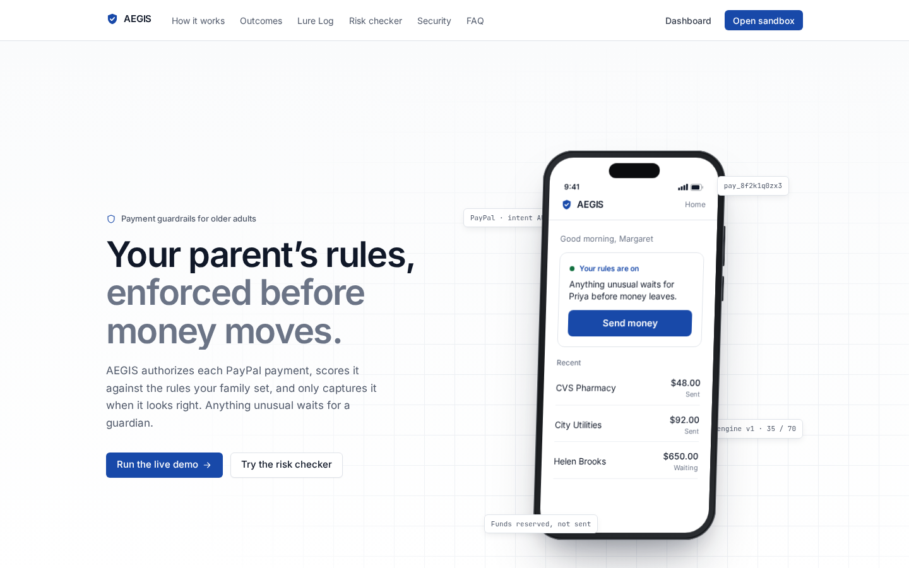

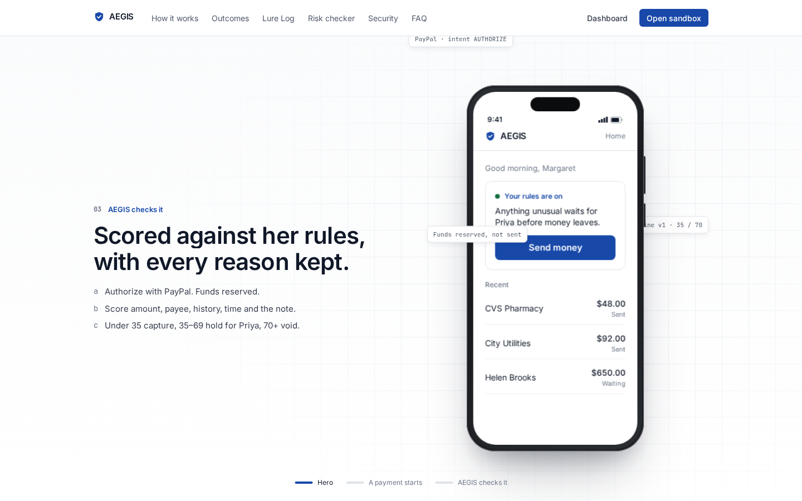

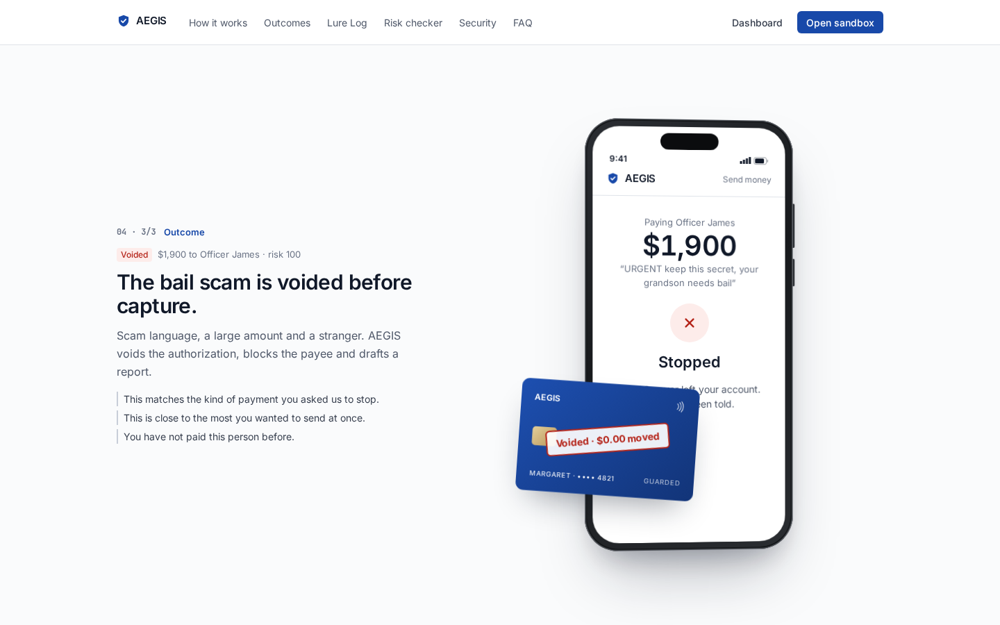

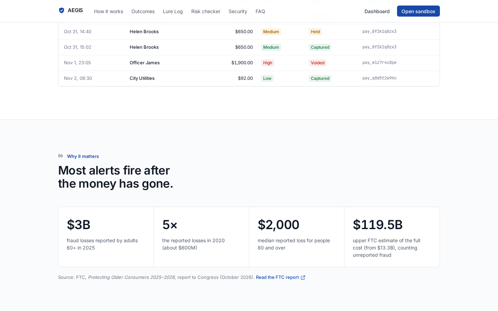

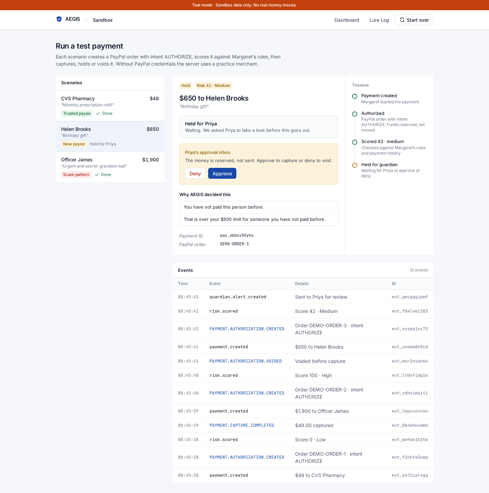

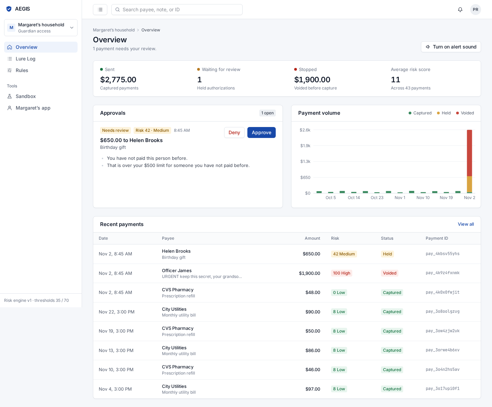

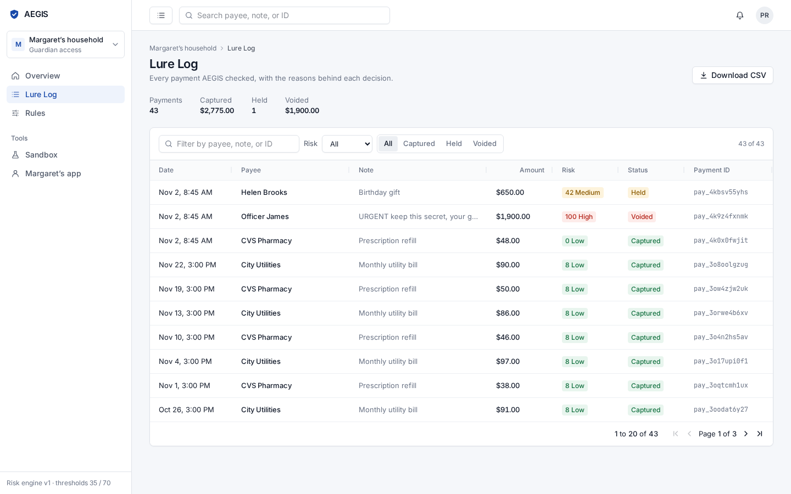

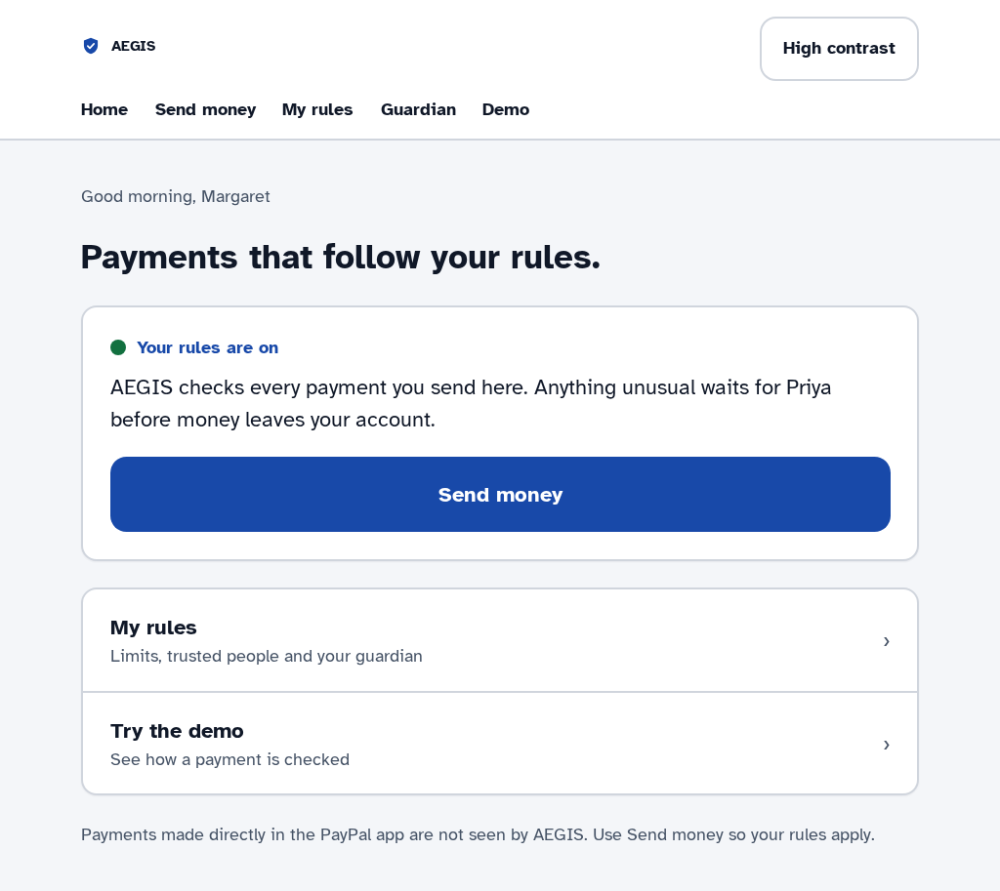

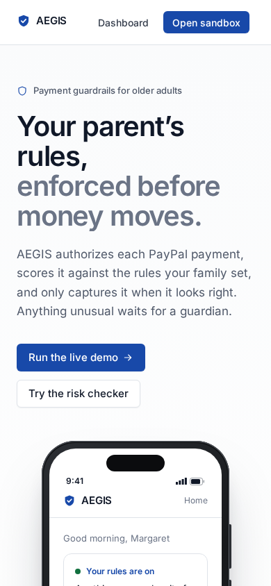

## Design

The UI follows patterns from established payment products rather than a concept look: one brand blue with neutral greys, green/amber/red only for status, Inter at 13–14px in the dashboard, 1px borders and 6–8px radii. The guardian dashboard is an admin shell (sidebar with account switcher, search, breadcrumbs, test-mode banner), payments show short IDs such as `pay_…`, and every payment opens a drawer with its Authorized → Scored → Captured/Held/Voided timeline. Margaret's screens keep a 22px base size, Atkinson Hyperlegible and a high-contrast mode.
