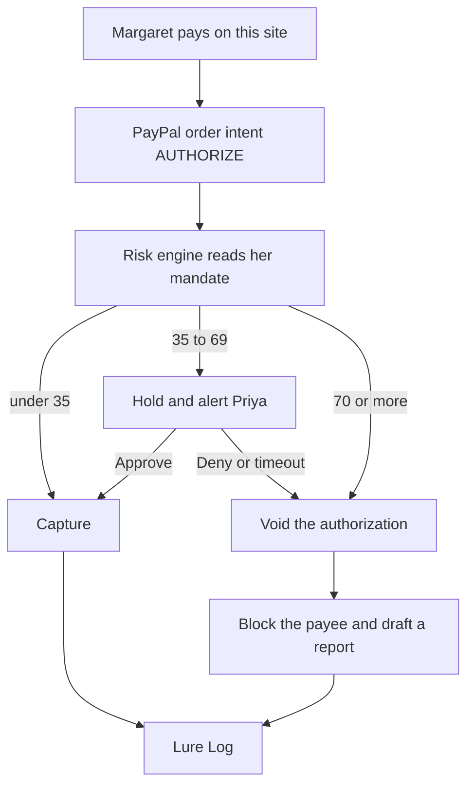

# AEGIS

AI consent proxy that enforces a vulnerable person's own wishes on every PayPal transaction.

A senior pays **through AEGIS**. AEGIS is the PayPal merchant: each payment is created with Orders v2 `intent=AUTHORIZE`, then a risk engine decides whether to capture it, hold it for a guardian, or void it.

Payments made directly in the PayPal app never reach AEGIS and cannot be intercepted.

## Why it exists

Margaret writes her wishes in ordinary sentences. AEGIS turns them into a versioned mandate: a cap for someone she has not paid before, a per-payment cap, a daily cap, people who are always allowed or always blocked, scam words, quiet hours, and Priya's name. The next payment is scored against that mandate. A low score is captured. A middle score waits for Priya. A high score is voided, the payee is blocked, and a draft complaint is saved. The Lure Log keeps every reason.

## Architecture

The score adds up the amount, a new payee, velocity, drift from her history, quiet hours, and scam wording. An always-block list forces a void. An always-allow list keeps a trusted payee low unless the note itself looks like a scam. Below 35 is low, 35 to 69 is medium, and 70 or more is high. Grok may rewrite the sentences. It does not change the score.
